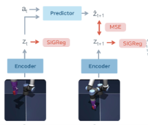

# 第一次组会
本次工作：精读LeWM论文与代码、学习Mujoco/Robosuite基础
## 1.LeWM论文
### 1.1 JEPA（联合嵌入预测架构）
JEPA通过编码器提取当前时刻状态和下一时刻状态的神经网络特征，并将下一时刻真实状态的编码特征和经预测器通过预测当前时刻状态得到的下一时刻预测状态的编码特征做比较，以训练模型。

由于是在表示空间进行预测，该架构有两层优势：
- 用该架构训练的模型与其他架构训练的模型达到同一水平的所需数据量要更小；（数据效率高）
- 用该架构训练的模型与其他架构训练的模型达到同一水平的所需人工标注标签量要更少；（标签效率高）
**问题: 易发生坍缩**
模型易于把任何状态均识别为相同变量，使得预测器成为恒等函数，此时Loss始终为0，训练无效。

### 1.2 LeWM：一种端到端稳定JEPA方法
LeWM通过编码器提取图像的特征，并将历史图像特征和对应动作输入预测器，得到下一时刻的预测特征。训练时，将预测特征与下一时刻图像的编码特征做比较，同时加入SIGReg正则项，使模型能够直接从图像和动作序列中进行端到端学习。该方法有以下优势：
- 预测器与编码器联合训练，鼓励保留与动作和控制有关的信息；
- 利用各向同性高斯分布，能够有效防止坍缩；
- 仅使用预测损失和正则损失，主要调节正则项权重，无需预训练编码器、停止梯度或指数移动平均；（训练流程简单）
**问题: 多步预测误差会累积**
规划时，模型将预测特征继续输入预测器，预测越远，误差越容易累积。可通过执行部分动作后重新观测、重新规划来减轻影响。

### 1.3 LeWM的物理性能
LeWM在学习图像和动作序列的过程中，能够在表示空间中保留部分物理信息。论文通过从特征中预测物理量、观察特征轨迹以及检测异常事件，评估模型对环境运动规律的理解。
实验结果主要体现在以下三个方面：
- 在PushT环境中，通过额外训练的探测模型，可从编码特征中预测位置和角度，表现优于PLDM；
- 在PushT环境中，特征轨迹随训练逐渐变直，且无需额外的轨迹平滑约束；
- 物体瞬移时，模型的预测误差明显增大，对颜色突变的反应则较弱；
**问题: 精细姿态信息仍有不足**
在三维环境中，模型对方块朝向、机械臂末端角度等细节的表示仍不充分，预测特征的可视化结果能够保留整体运动，但可能丢失精细姿态。

## 2.Mujoco/Robosuite
### 2.1 介绍
- Mujoco是一款物理仿真引擎，负责计算物体的位置、速度、碰撞、摩擦、关节运动等物理现象。
- Robosuite是基于Mujoco的机器人学习仿真框架，提供现成的机器人、操作任务、控制器、传感器和奖励函数。（类似HAL之于STM32）

### 2.2 主要功能
1. 模型构建
Mujoco可以定义一个完整的物理世界，支持自定义世界参数、物体形状、位置、质量、自由度、接触属性。
主要使用MJCF格式定义，同时兼容URDF格式（ROS）。
Robosuite创建好了许多预定义场景与模块，只需要在代码中简单声明就可以完成构建完整场景，进行机器人初始化等工作
2. 动力学计算
当机器人受到控制力矩、重力或接触力时，MuJoCo 计算系统下一时刻的状态。其机械系统动力学通常可以表示为：
$$
M(q)\ddot q+C(q,\dot q)+g(q)=\tau+J^Tf
$$
即拉格朗日力学，并根据物理模型计算系统的广义加速度 $\ddot q$ ，用数值积分方法更新 $\dot q$ 与 $q$ ，求解下一时刻状态。
3. 控制输入
Mujoco支持对机器人的各项参数施加控制输入，其具体实现方式为施加一组控制向量以控制预先定义好的控制器，或是直接施加广义力、刚体外力。
例如：
```xml
<actuator>
    <motor joint="joint1" gear="1"/>
    <position joint="joint2" kp="100"/>
    <velocity joint="joint3" kv="10"/>
</actuator>
```
向该MJCF配置施加输入：
```python
data.ctrl[:] = [0.5, 0.2, -0.3]
mujoco.mj_step(model, data)
```
则得到了对电机控制信号输入0.5，关节目标位置输入0.2，关节目标速度输入-0.3。注意这并非代表实际目标力矩、位置与速度。
Robosuite则提供了一系列高级控制器，支持提供多维度运动，位置，旋转等指令。
4. 读取与更新系统状态
Mujoco可以通过模拟传感器保存和读取仿真中的动态变量，如广义位置、广义速度、当前仿真时间等。
Robosuite则将其整理为更方便机器学习使用的Observation，如某个特定关节位置，任务物体相关状态，摄像头RGB图像等。Robosuite还支持判断和提供任务奖励。
5. 可视化
Mujoco提供了Mujoco Viewer，能够根据设置直接观察与调试底层物理模型。

Mujoco支持离屏渲染，即不经过实际图像显示直接生成程序可以处理的数组，包括以下几类：
- RGB Image，模拟普通摄像头画面，每个像素包含红绿蓝三个通道；
- Depth Image，表示摄像头看到的场景深度信息，可以通过该信息分析三维空间结构；
- Segmentation Image，为不同物体或几何部分分配标识，使程序区分机械臂、方块、桌子等。
Robosuite基于上述两种功能提供了不同的调用方式和高级封装。